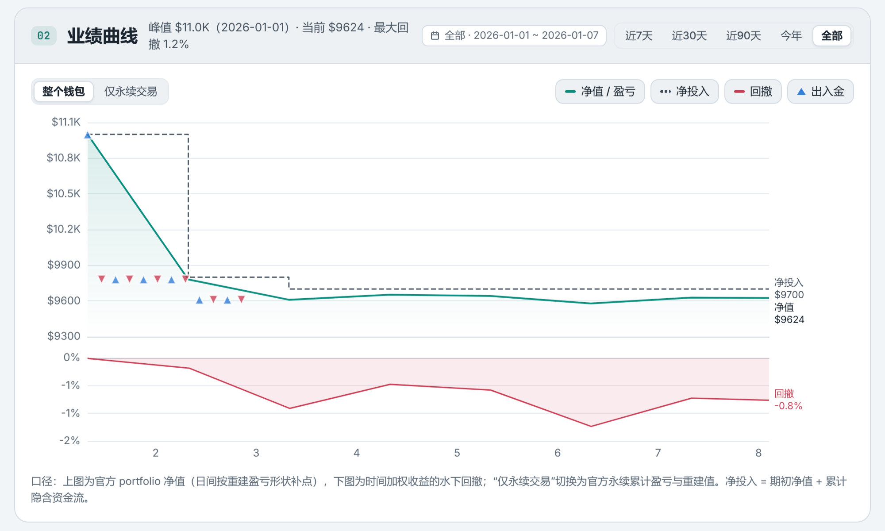

# yutianjiang

<h3>Trading Systems Engineer</h3>

**Low-Latency Trading Infrastructure · Rust & Python Engineering**

---

## 01 · Introduction · 简介

Specialized in low-latency trading infrastructure for on-chain markets, with expertise in Rust execution engines and Python control, operations and analytics tooling. Author and maintainer of [Multisource HL Copy](https://github.com/yutianjiang39/Multisource_HL_Copy) and [Hyperliquid Monitor](https://github.com/yutianjiang39/Hyperliquid_Monitor); contributor to open-source trading and data libraries including [pybotters](https://github.com/pybotters/pybotters), [hypersdk](https://github.com/infinitefield/hypersdk) and [petl](https://github.com/petl-developers/petl). Currently focused on multi-source execution reliability on Hyperliquid and performance analytics reconciled against official figures.

专注于链上市场的低延迟交易基础设施，精通 Rust 执行引擎与 Python 控制、运维及分析工具的开发。主导开发并维护 [Multisource HL Copy](https://github.com/yutianjiang39/Multisource_HL_Copy) 与 [Hyperliquid Monitor](https://github.com/yutianjiang39/Hyperliquid_Monitor)，参与 [pybotters](https://github.com/pybotters/pybotters)、[hypersdk](https://github.com/infinitefield/hypersdk)、[petl](https://github.com/petl-developers/petl) 等开源交易与数据处理库的开发。目前致力于 Hyperliquid 多来源执行的可靠性，以及可与官方数据对账的业绩分析。

<!-- TODO(个人信息占位 / personal info placeholders) — 填写后取消注释 / uncomment after filling in
- **Based in:** <LOCATION>
- **Role:** <ROLE / COMPANY>
-->

## 02 · Expertise & Stack · 工程能力与技术栈

| | |
| --- | --- |
| **Rust** | High-performance, concurrent systems · 高性能并发系统     |
| **Python** | Tooling, automation and data analysis · 工具、自动化与数据分析        |
| **Trading Systems** | End-to-end execution across exchanges and brokers · 跨交易所与券商的端到端交易执行     |
| **Performance** | Low-latency design and optimization · 低延迟设计与优化  |
| **Reliability** | Systems that stay correct under failure · 故障下依然正确运行的系统      |

## 03 · Featured Projects · 精选项目

### [Multisource HL Copy](https://github.com/yutianjiang39/Multisource_HL_Copy)

A low-latency copy-trading engine for Hyperliquid that follows multiple sources at once, with built-in risk control.

面向 Hyperliquid 的低延迟跟单引擎，同时跟随多个来源，内置风险控制。

<b>Architecture · 系统架构</b>

<picture>
  <source media="(prefers-color-scheme: dark)" srcset="assets/multisource-hl-copy-architecture-dark.svg" />
  <source media="(prefers-color-scheme: light)" srcset="assets/multisource-hl-copy-architecture-light.svg" />
  
</picture>

Conceptual diagram; execution algorithms and parameters are not shown. 示意图，不含执行算法与参数。

> Public showcase repository; the production implementation remains private. · 公开展示仓库，生产实现保持私有。

### [Hyperliquid Monitor](https://github.com/yutianjiang39/Hyperliquid_Monitor)

A local-first wallet analytics tool for Hyperliquid: performance and risk metrics reconciled against official figures, delivered as an offline HTML report. No private key required.

面向 Hyperliquid 的本地优先钱包分析工具：业绩与风险指标与官方数据对账，输出离线 HTML 报告，无需私钥。

From the built-in demo report (`python app.py demo`), simulated data. 取自内置演示报告，模拟数据。

<b>Architecture · 系统架构</b>

<picture>
  <source media="(prefers-color-scheme: dark)" srcset="assets/hyperliquid-monitor-architecture-dark.svg" />
  <source media="(prefers-color-scheme: light)" srcset="assets/hyperliquid-monitor-architecture-light.svg" />
  
</picture>

## 04 · Open Source Contributions · 开源贡献

| Project · 项目 | Stars | Contributions · 贡献 | Highlight · 代表作 |
| --- | --- | --- | --- |
| [petl-developers/petl](https://github.com/petl-developers/petl) |  | [9 merged](https://github.com/petl-developers/petl/pulls?q=is%3Apr+author%3Ayutianjiang39+is%3Amerged) · [2 in review](https://github.com/petl-developers/petl/pulls?q=is%3Apr+author%3Ayutianjiang39+is%3Aopen) | [#868](https://github.com/petl-developers/petl/pull/868) `toxlsx` preserves VBA projects when updating Excel sheets · 更新 Excel 时保留 VBA 工程 [#866](https://github.com/petl-developers/petl/pull/866) `unflatten` yields complete rows before reading more input · `unflatten` 先产出完整行再读取输入 [#841](https://github.com/petl-developers/petl/pull/841) `crossjoin` no longer drops rows from one-shot inputs · 修复一次性迭代输入丢行 |
| [pybotters/pybotters](https://github.com/pybotters/pybotters) |  | [2 merged](https://github.com/pybotters/pybotters/pulls?q=is%3Apr+author%3Ayutianjiang39+is%3Amerged) · [3 in review](https://github.com/pybotters/pybotters/pulls?q=is%3Apr+author%3Ayutianjiang39+is%3Aopen) | [#593](https://github.com/pybotters/pybotters/pull/593) cancelled DataStore waiters are released on idle stores · 空闲 DataStore 释放已取消的等待者 [#591](https://github.com/pybotters/pybotters/pull/591) order-book sorting honors a zero depth limit · 订单簿零深度上限修复 |
| [infinitefield/hypersdk](https://github.com/infinitefield/hypersdk) |  | [1 merged](https://github.com/infinitefield/hypersdk/pulls?q=is%3Apr+author%3Ayutianjiang39+is%3Amerged) | [#112](https://github.com/infinitefield/hypersdk/pull/112) Uniswap V3 positions at the upper tick are treated as out of range · Uniswap V3 仓位上边界区间判定修复 |

**In review · 审核中**

- **Hyperliquid** — [hyperliquid-python-sdk #349](https://github.com/hyperliquid-dex/hyperliquid-python-sdk/pull/349) · [nktkas/hyperliquid #204](https://github.com/nktkas/hyperliquid/pull/204) · [hyperliquid-trading-bot #21](https://github.com/chainstacklabs/hyperliquid-trading-bot/pull/21)
- **Trading engines · 交易引擎** — [nautilus_trader #5771](https://github.com/nautechsystems/nautilus_trader/pull/5771)
- **Brokers & exchanges · 券商与交易所** — [coinbase-advanced-py #145](https://github.com/coinbase/coinbase-advanced-py/pull/145) · [#146](https://github.com/coinbase/coinbase-advanced-py/pull/146) · [#147](https://github.com/coinbase/coinbase-advanced-py/pull/147) · [alpaca-py #932](https://github.com/alpacahq/alpaca-py/pull/932) · [#933](https://github.com/alpacahq/alpaca-py/pull/933) · [#934](https://github.com/alpacahq/alpaca-py/pull/934)
- **Data tooling · 数据工具** — [pyjanitor #1874](https://github.com/pyjanitor-devs/pyjanitor/pull/1874) · [#1875](https://github.com/pyjanitor-devs/pyjanitor/pull/1875) · [#1876](https://github.com/pyjanitor-devs/pyjanitor/pull/1876) · [#1877](https://github.com/pyjanitor-devs/pyjanitor/pull/1877) · [#1878](https://github.com/pyjanitor-devs/pyjanitor/pull/1878) · [#1879](https://github.com/pyjanitor-devs/pyjanitor/pull/1879)
- **Rust** — [rust-decimal #897](https://github.com/paupino/rust-decimal/pull/897)

[All pull requests](https://github.com/search?q=is%3Apr+author%3Ayutianjiang39+-user%3Ayutianjiang39&type=pullrequests) · 全部 PR

## 05 · Engineering Principles · 工程理念

- **Correctness first, then speed.** A fast system that is wrong is still wrong.

  **先正确，再求快。** 跑得再快，结果错了也毫无意义。

- **Keep it simple.** Fewer moving parts mean fewer surprises in production.

  **保持简单。** 组件越少，线上的意外就越少。

- **Measure, don't guess.** Decisions follow data, not intuition.

  **用数据说话。** 决策依据数据，而非直觉。

- **Fix it upstream.** When a library is wrong, fix it at the source and give back.

  **在上游修复。** 依赖库有问题，就从源头修好并回馈社区。

## 06 · Contact · 联系方式

- **Email** — [yutianjiang39@gmail.com](mailto:yutianjiang39@gmail.com) for roles, collaboration and technical discussion · 工作机会、合作与技术交流请发邮件

- **Project questions** — open an issue in the relevant repository: [Multisource HL Copy](https://github.com/yutianjiang39/Multisource_HL_Copy/issues) · [Hyperliquid Monitor](https://github.com/yutianjiang39/Hyperliquid_Monitor/issues) · 项目相关问题请在对应仓库提 issue
- **Security reports** — see [SECURITY.md](https://github.com/yutianjiang39/Multisource_HL_Copy/blob/main/SECURITY.md) · 安全问题见 SECURITY.md

<!-- TODO(联系方式占位 / contact placeholders) — 填写后取消注释 / uncomment after filling in
- **LinkedIn** — <URL>
- **Website** — <URL>
- **X / Twitter** — <HANDLE>
- **Telegram** — <HANDLE>
-->

---

  <picture>
    <source media="(prefers-color-scheme: dark)" srcset="https://raw.githubusercontent.com/yutianjiang39/yutianjiang39/output/github-contribution-grid-snake-dark.svg" />
    <source media="(prefers-color-scheme: light)" srcset="https://raw.githubusercontent.com/yutianjiang39/yutianjiang39/output/github-contribution-grid-snake.svg" />
    
  </picture>

  Trading Systems Engineer · Rust & Python · Nothing here is financial advice · 本页内容不构成投资建议

