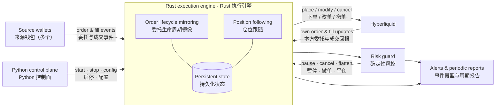
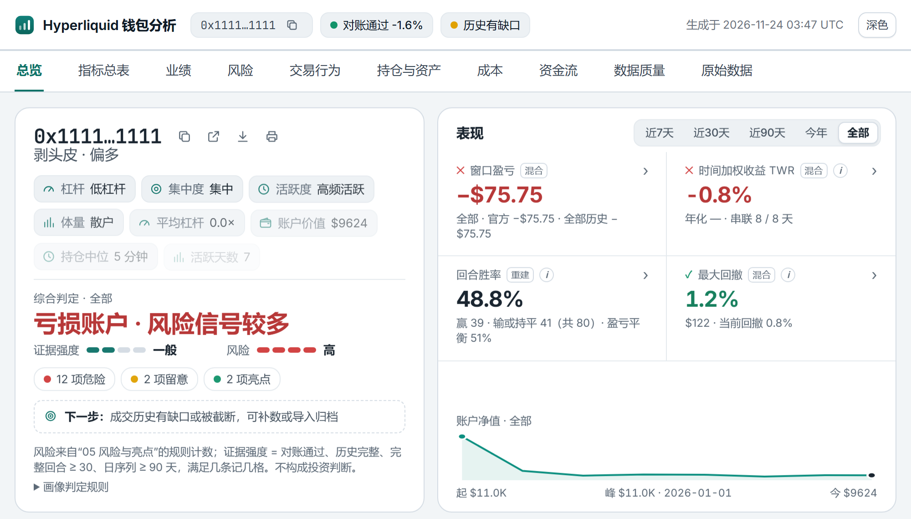
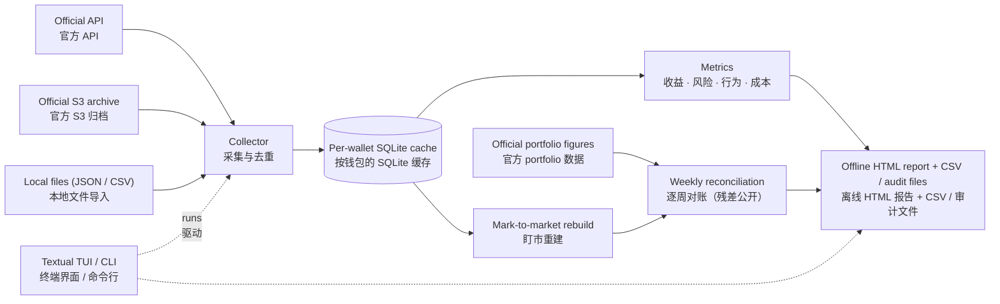

# yutianjiang

<h3>Trading Systems Engineer</h3>

**Low-Latency Trading Infrastructure · Rust & Python Engineering**

---

## 01 · Introduction · 简介

I build trading infrastructure for on-chain markets: Rust on the latency-critical execution path, Python for control, operations and analytics. I maintain [Multisource HL Copy](https://github.com/yutianjiang39/Multisource_HL_Copy) and [Hyperliquid Monitor](https://github.com/yutianjiang39/Hyperliquid_Monitor).

我做链上交易基础设施：延迟敏感的执行路径用 Rust，控制、运维与分析用 Python。维护 [Multisource HL Copy](https://github.com/yutianjiang39/Multisource_HL_Copy) 与 [Hyperliquid Monitor](https://github.com/yutianjiang39/Hyperliquid_Monitor)。

<!-- TODO(个人信息占位 / personal info placeholders) — 填写后取消注释 / uncomment after filling in
- **Based in:** <LOCATION>
- **Role:** <ROLE / COMPANY>
-->

## 02 · Core Expertise · 核心能力

| | |
| --- | --- |
| **Rust** | Asynchronous runtimes, event-driven engines, PyO3 bindings · 异步运行时、事件驱动引擎、PyO3 绑定 |
| **Python** | Control planes, test automation, operations tooling · 控制面、自动化测试、运维工具 |
| **Execution Systems** | Order lifecycle, position management, multi-source following · 委托生命周期、仓位管理、多来源跟随 |
| **Performance Engineering** | Latency profiling and load testing on the execution path · 执行路径的延迟剖析与负载测试 |
| **Risk & Reliability** | Deterministic guards, persistent state and recovery, observability · 确定性风控、状态持久化与恢复、可观测性 |

## 03 · Featured Projects · 精选项目

### [Multisource HL Copy](https://github.com/yutianjiang39/Multisource_HL_Copy)

A multi-source copy-trading execution engine for Hyperliquid: event-driven architecture, real-time execution in Rust, multi-target following, with integrated risk controls and operational observability.

面向 Hyperliquid 的多来源跟单执行引擎：事件驱动架构、Rust 实时执行、多目标跟随，内置风险控制与运行可观测性。

| | |
| --- | --- |
| **Architecture · 架构** | Rust execution engine with a Python control and reporting plane · Rust 执行引擎 + Python 控制与报告面 |
| **Scope · 范围** | Order lifecycle mirroring, position management, risk intervention, reporting · 委托生命周期镜像、仓位管理、风险干预、运行报告 |
| **Evidence · 实测** | Recorded latency and load results, with their test conditions, are in the [repository README](https://github.com/yutianjiang39/Multisource_HL_Copy#readme) · 延迟与负载实测结果及测试口径见仓库 README |

**Architecture · 系统架构**

Conceptual diagram of the public capability description; it does not show execution algorithms or parameters. 按公开能力说明绘制的示意图，不含执行算法与参数。

> Public showcase repository; the production trading implementation remains private.
>
> 公开展示仓库，生产交易实现保持私有。

### [Hyperliquid Monitor](https://github.com/yutianjiang39/Hyperliquid_Monitor)

A local-first wallet analytics tool for Hyperliquid: returns, drawdown and risk are anchored to the official portfolio figures, reconciled against an independent mark-to-market rebuild, and delivered as a fully offline HTML report. It runs on your own machine, and public queries need no private key.

面向 Hyperliquid 的本地优先钱包分析工具：收益、回撤与风险指标锚定官方 portfolio 数据，与独立的盯市重建逐周对账，并输出完全离线的 HTML 报告。程序在本机运行，公开查询不需要私钥。

| | |
| --- | --- |
| **Architecture · 架构** | Python pipeline with a Textual terminal UI and a CLI, a per-wallet SQLite cache, and a self-contained report · Python 数据管线 + Textual 终端界面与命令行，按钱包的 SQLite 缓存，自包含报告 |
| **Metrics · 指标** | Returns (TWR, XIRR), risk (drawdown, Sharpe, Sortino, VaR/CVaR), trading behaviour, costs and positions · 收益（TWR、XIRR）、风险（回撤、Sharpe、Sortino、VaR/CVaR）、交易行为、成本与持仓 |
| **Data quality · 数据质量** | Weekly reconciliation against official cumulative PnL; residuals, history gaps and the source of every number are shown in the report · 与官方累计盈亏逐周对账；残差、历史缺口与每个数字的来源都在报告中公开 |
| **Docs · 文档** | Usage, data scope and accounting rules are in the [repository README](https://github.com/yutianjiang39/Hyperliquid_Monitor#readme) (Chinese) · 用法、数据口径与计算规则见仓库 README |

Two sections of the offline HTML report produced by `python app.py demo` — simulated data, no real wallet. 两张图取自 `python app.py demo` 生成的离线报告，数据为模拟数据，不涉及真实钱包。

**Architecture · 系统架构**

> Read-only analytics: it reports on a wallet's history and never places orders.
>
> 只读分析工具：只呈现钱包历史，不会下单。

## 04 · Technical Stack · 技术栈

**Languages · 语言**

**Rust ecosystem · Rust 生态**

**Python ecosystem · Python 生态**

**Data & Operations · 数据与运维**

## 05 · Engineering Principles · 工程理念

- **Measure in percentiles, under stated load.** Local, simulated and live end-to-end numbers are reported separately; no single headline figure.

  **按分位数、在明确负载下测量。** 本地、模拟与实盘端到端的数字分开呈现，不用单一峰值概括。

- **Risk control is architecture.** Guards are deterministic, state survives a restart, and every intervention leaves an auditable record.

  **风控属于架构本身。** 风控规则是确定性的，状态能在重启后恢复，每次干预都留下可审计的记录。

- **Audit the numbers.** Metrics are anchored to the venue's official figures, rebuilt independently from fills, and reconciled with the residuals shown.

  **数字要经得起审计。** 指标锚定官方数据，由成交独立重建并对账，残差公开。

## 06 · Contact · 联系方式

- **Project questions** — open an issue in the relevant repository: [Multisource HL Copy](https://github.com/yutianjiang39/Multisource_HL_Copy/issues) · [Hyperliquid Monitor](https://github.com/yutianjiang39/Hyperliquid_Monitor/issues) · 项目相关问题请在对应仓库提 issue
- **Security reports** — see [SECURITY.md](https://github.com/yutianjiang39/Multisource_HL_Copy/blob/main/SECURITY.md) · 安全问题见 SECURITY.md

<!-- TODO(联系方式占位 / contact placeholders) — 填写后取消注释 / uncomment after filling in
- **Email** — <EMAIL>
- **LinkedIn** — <URL>
- **Website** — <URL>
- **X / Twitter** — <HANDLE>
- **Telegram** — <HANDLE>
-->

---

  <picture>
    <source media="(prefers-color-scheme: dark)" srcset="https://raw.githubusercontent.com/yutianjiang39/yutianjiang39/output/github-contribution-grid-snake-dark.svg" />
    <source media="(prefers-color-scheme: light)" srcset="https://raw.githubusercontent.com/yutianjiang39/yutianjiang39/output/github-contribution-grid-snake.svg" />
    
  </picture>

  Trading Systems Engineer · Rust & Python · Nothing here is financial advice · 本页内容不构成投资建议

